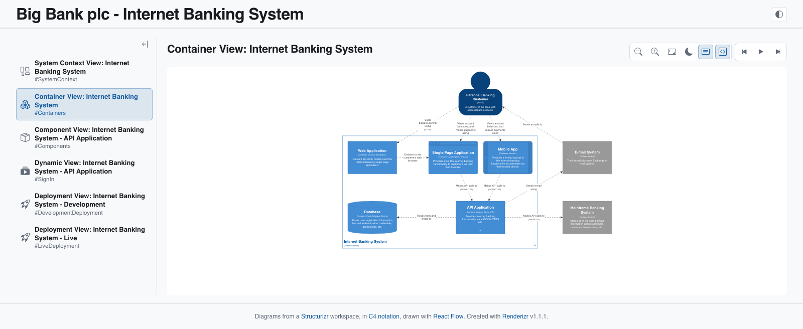

# 

[](https://github.com/FormulaMonks/renderizr/actions/workflows/ci.yml) [](https://nodejs.org) [](LICENSE)

Render a [Structurizr](https://structurizr.com/) workspace (its diagrams, documentation and architecture decisions) as a static site, or as a single self-contained HTML file you can host anywhere. You need Node 22.12 or newer and nothing else.

```bash
npx github:FormulaMonks/renderizr https://raw.githubusercontent.com/structurizr/structurizr/main/structurizr-export/src/test/resources/big-bank-plc.json
```

<picture>
  <source media="(prefers-color-scheme: dark)" srcset="docs/screenshot-dark.png">
  
</picture>

## Documentation

**[formulamonks.github.io/renderizr](https://formulamonks.github.io/renderizr/)** holds the whole documentation, rendered by Renderizr from its own workspace at each release:

- [Getting started](https://formulamonks.github.io/renderizr/#/?page=docs&section=01-getting-started): who it is for, requirements, your first render and what you get.
- [Usage](https://formulamonks.github.io/renderizr/#/?page=docs&section=02-usage): every [option](https://formulamonks.github.io/renderizr/#/?page=docs&section=02-usage&subsection=options), [branding from the workspace](https://formulamonks.github.io/renderizr/#/?page=docs&section=02-usage&subsection=branding-from-the-workspace), the [single file](https://formulamonks.github.io/renderizr/#/?page=docs&section=02-usage&subsection=single-file), [export](https://formulamonks.github.io/renderizr/#/?page=docs&section=02-usage&subsection=export), [edit mode](https://formulamonks.github.io/renderizr/#/?page=docs&section=02-usage&subsection=edit-mode), [use from an AI agent](https://formulamonks.github.io/renderizr/#/?page=docs&section=02-usage&subsection=use-renderizr-from-an-ai-agent) and [how it compares with structurizr-site-generatr](https://formulamonks.github.io/renderizr/#/?page=docs&section=02-usage&subsection=renderizr-or-structurizr-site-generatr).
- [Contributing](https://formulamonks.github.io/renderizr/#/?page=docs&section=03-contributing): from a clone to a merged pull request.
- [Reference](https://formulamonks.github.io/renderizr/#/?page=docs&section=04-reference): local development, every pnpm script, Structurizr's tools for edit mode, the project layout and adding a test.
- [Decisions](https://formulamonks.github.io/renderizr/#/?page=adrs): the architecture decision log.

`npx github:FormulaMonks/renderizr --help` prints every flag as text.

## Contributing

Bug reports, feature requests and pull requests are all welcome. [CONTRIBUTING.md](CONTRIBUTING.md) has the workflow, and [SUPPORT.md](SUPPORT.md) says where each kind of question goes. Report a security problem privately through [GitHub Security Advisories](https://github.com/FormulaMonks/renderizr/security/advisories/new), never as a public issue; [SECURITY.md](SECURITY.md) has the response timeline.

## License

MIT, see [LICENSE](LICENSE). Copyright (c) 2024-2026 Monks Tech Services. [THIRD-PARTY-NOTICES.md](THIRD-PARTY-NOTICES.md) lists the code every rendered page bundles, and [NOTICE](NOTICE) is the short form.
