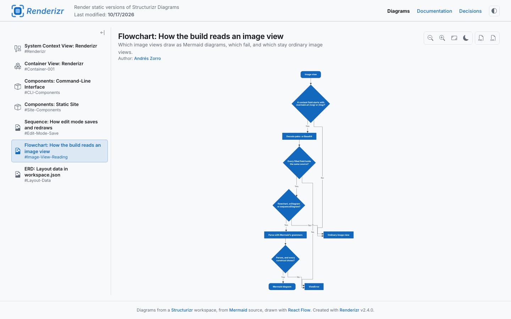
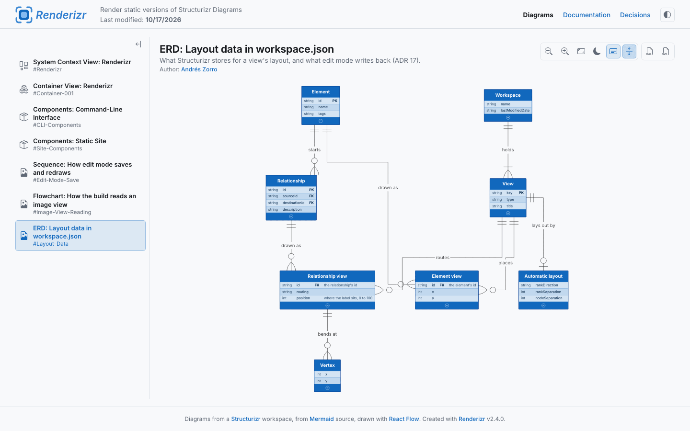
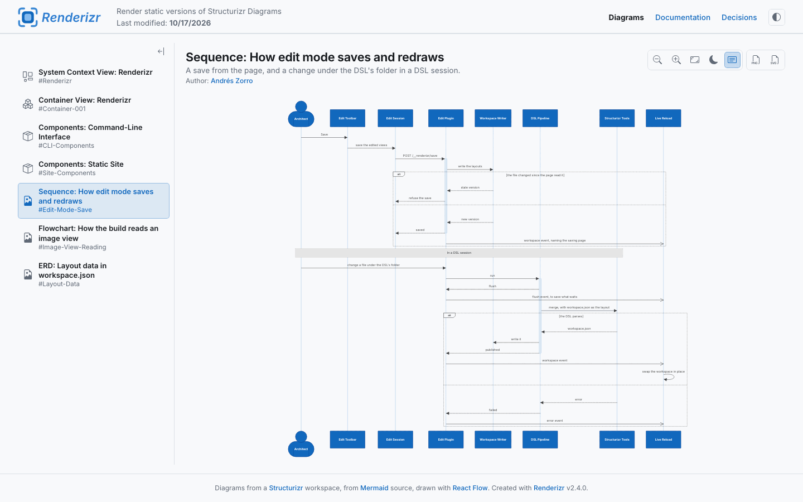
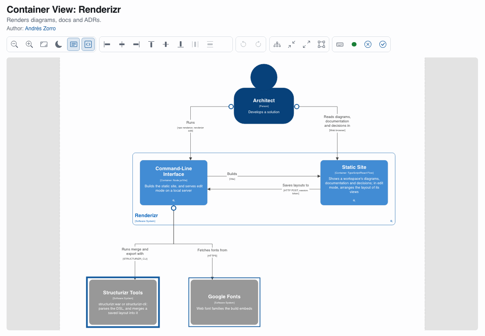
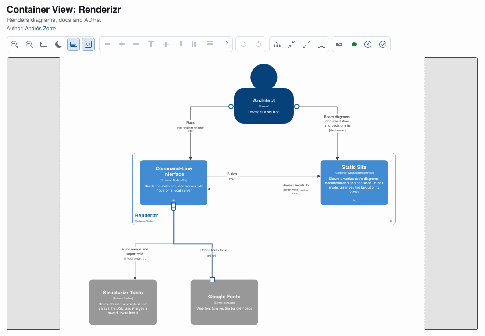

# Usage

```bash
npx github:FormulaMonks/renderizr <workspace> [options]
npx github:FormulaMonks/renderizr edit [path] [options]
```

The first form renders a workspace. The second starts [edit mode](#edit-mode). `renderizr --help` and `renderizr edit --help` print the same reference as text.

## Options

The one required argument is the workspace: a local path or an `http(s)` URL to a Structurizr workspace **JSON** file. Every flag is optional.

```bash
npx github:FormulaMonks/renderizr ./workspace.json \
  --single-file \
  --logo ./logo.svg \
  --font "Inter"
```

| Flag | Effect |
| --- | --- |
| `-o, --out <dir>` | Output directory, relative to the current directory. Default `structurizr-output`. The build empties it first |
| `--single-file` | Emit one self-contained `index.html` with every asset inlined, plus `artifact.html` |
| `--base <path>` | Base public path for the multi-file build. The default is empty, which emits relative URLs (`./assets/…`) that work from any folder. Set it to a path such as `/renderizr/` when the page must reference its assets absolutely |
| `--logo <path\|url>` | Image at the top left of the header: a path relative to the current directory, a URL or a `data:` URI. The build fetches it, minifies it when it is SVG, and embeds it as a data URI. It recognizes PNG, JPEG, GIF, WebP and SVG from their bytes, and rejects an SVG that holds a script |
| `--logo-alt <text>` | Alt text for the logo. Default empty. When it matches the workspace name, the logo stands in for the title in the header, so a logo that spells the name does not repeat it |
| `--logo-href <url>` | Wraps the logo in a link |
| `--font <family>` | A [Google Fonts](https://fonts.google.com) family, such as `Inter` or `"Source Sans 3"`. The build downloads it from Google Fonts, its one font source, as woff2 and embeds it, diagram labels included |
| `--font-weights <list>` | Comma-separated weights. Default `400,700`. The build prefers a variable font that covers the range when the family has one |
| `--font-subsets <list>` | Comma-separated subsets. Default `latin` |
| `--font-italic` | Also embed the italic faces, which roughly doubles the font's weight |
| `--primary-color <color>` | A CSS color, such as `#e4572e` or `rgb(228 87 46)`, for links, the active page and view, edit mode's marks and the nodes of a [Mermaid diagram](#mermaid-diagrams) whose source sets no theme, in light and dark alike. Default is Renderizr's blue |
| `-h, --help` | Print the reference as text and exit |

A font is the one option with a real cost: an embedded family outweighs every other option together, and each extra weight, subset or italic face adds to it.

## Branding from the workspace

Set the logo, the font and the primary color once in the workspace, and every run of `renderizr` and `renderizr edit` uses them without flags:

```
workspace {
    properties {
        "renderizr.logo" "logo.svg"
        "renderizr.logoAlt" "Acme"
        "renderizr.logoHref" "https://acme.example"
        "renderizr.font" "Inter"
        "renderizr.primaryColor" "#e4572e"
    }
}
```

| Property | Holds | Flag that overrides it |
| --- | --- | --- |
| `renderizr.logo` | The header logo: a path relative to the workspace file, or to the workspace URL when you render from one, a URL or a `data:` URI | `--logo` |
| `renderizr.logoAlt` | The logo's alt text | `--logo-alt` |
| `renderizr.logoHref` | The link around the logo | `--logo-href` |
| `renderizr.font` | A Google Fonts family name, the value `--font` takes | `--font` |
| `renderizr.primaryColor` | A CSS color | `--primary-color` |

- A flag overrides its property for that run. When a run passes a flag whose value differs from the workspace, Renderizr prints a `properties` block to paste into the workspace, with a logo path relative to the workspace file.
- Renderizr checks a property the way it checks its flag. An invalid value fails the build, or the start of edit mode, and the error names the property and the workspace.
- Renderizr reads these properties and never writes them. It skips Structurizr's `branding` block, and prints a notice when that block sets a logo or a font that no property sets.
- Edit mode applies branding when it starts. When you change a property while it runs, it asks you to restart `renderizr edit`.
- `--font-weights`, `--font-subsets` and `--font-italic` have no properties yet.

## Default output

Without `--single-file`, the build writes `index.html`, an `assets/` folder and a favicon. The files use relative URLs, so the site works from any folder of a static host such as GitHub Pages or S3. Use `--base` when a host needs absolute asset paths.

The footer of every page says what is on screen and which Renderizr built it: a C4 view is in C4 notation and drawn with React Flow, a Mermaid diagram comes from Mermaid source and is drawn with React Flow, a picture names only the workspace, and the documentation and decisions pages say whose they are.

## Single file

`--single-file` inlines every stylesheet, script, font, icon and the workspace itself into one document that makes no network requests at all:

```bash
npx github:FormulaMonks/renderizr ./workspace.json --single-file
```

The build writes two files:

| File | Use it for |
| --- | --- |
| `index.html` | Anywhere a URL can point: GitHub Pages, S3, an email attachment, or straight off your disk over `file://` |
| `artifact.html` | Hosts that supply their own document scaffolding, such as a Claude artifact. It holds the same page without its own `<html>`, `<head>` or `<body>` |

Pick the single file when a folder of files is hard to hand over. One file goes in a chat message, an email, a wiki attachment or a bucket with no build step, and it opens off a USB stick on a machine with no network.

The build fetches themes, element icons and a logo referenced by URL, and folds them all in. The page never reaches for the network, so it also works under a strict content security policy.

## Export

Two buttons at the end of the diagram toolbar save the view on screen as a file: **Export view as PNG** and **Export view as SVG**. Every build has them, single file or not, and every view the engine draws has them, a [Mermaid diagram](#mermaid-diagrams) included; an image view that shows a picture has none.

An export shows the view as drawn: the diagram color scheme, the animation step and the description and technology toggles the reader has on. The view's canvas frames it: its `dimensions`, else its paper size, else the content with 200 pixels of room on each side. A title block runs below the canvas, in the diagram's font and colors:

1. The view's title in bold, when it has one.
2. The view's description, wrapped to the canvas width and cut to four lines, when it has one.
3. "Author:" and the workspace's `lastModifiedUser`, else its `lastModifiedAgent`.
4. "Last updated:" and the workspace's `lastModifiedDate`, else the date of the build, in the reader's locale.
5. "Created with Renderizr" and the version that built the site, smaller and lighter than the lines above it.

Every export carries the author, date and credit lines. Each one prints "Unknown" only when the workspace holds neither of its values.

The SVG keeps every label as real text and embeds the page's font, so it stays sharp at any size and fetches nothing. The PNG is twice the size of the SVG, and lowers its scale for a large canvas so it holds at most 16,777,216 pixels, which every browser can draw.

The file takes the workspace's name and the view's key in kebab-case, then the step and the scheme when they apply: `big-bank-plc-system-context.png` for the full view in light, `big-bank-plc-sign-in-step-2-dark.svg` for step 2 of a dynamic view in dark. While an export runs, its button shows busy; when one fails, the toolbar says "Couldn't export this view".

In edit mode, an export shows the layout as you left it, saved or not, without the selection, guides or canvas fill.

Inside a Claude artifact, the page saves an export through the artifact viewer's `downloads` capability, which asks the reader to confirm each file. A save the reader declines ends quietly. An artifact published without `downloads` can't save a file, so its toolbar shows no export buttons: declare `downloads` when you publish `artifact.html`.

An element icon given as an `http(s)` URL stays blank in an export. A build embeds every icon in the page, so this only happens on the dev server, which leaves such icons as URLs.

## Mermaid diagrams

Renderizr draws a Mermaid flowchart, ERD or sequence diagram that an image view carries as a **Mermaid diagram**, in the workspace's font and color scheme, with the zoom, fit, color scheme and export buttons every view has. Write it the way Structurizr reads it, with the `mermaid` keyword, and change nothing else in the DSL:

```
views {
    properties {
        "mermaid.url" "https://mermaid.ink"
    }

    image * "order-flow" {
        mermaid order-flow.mmd
        title "Order flow"
    }
}
```

Structurizr encodes the source into the image view's content as a URL on the Mermaid server that `mermaid.url` names, on the image view or on the views. The build reads the source back from that URL and parses it with Mermaid's own grammar, so the page never fetches the Mermaid server's picture. The workspace keeps opening in Structurizr as before.

A source that opens with `flowchart`, `graph`, `erDiagram` or `sequenceDiagram` draws. Every other image view stays a picture with no warning: a picture file, Mermaid that Structurizr inlines with `mermaid.inline true`, and every other Mermaid type.

Renderizr's own architecture carries one of each, under `architecture/mermaid/`: a flowchart of how the build reads an image view, an ERD of the layout data Structurizr keeps in `workspace.json`, and a sequence diagram of how edit mode saves a layout and draws a DSL session again.

The view's `title` names the diagram, then the source's frontmatter `title`, then `Image View: <key>`. The frontmatter title never draws on the canvas. In edit mode a Mermaid diagram draws read-only, since Structurizr keeps no layout for an image view, and a DSL session draws it again when its `.mmd` file under the DSL's folder changes.

> [!TIP]
> Choose every color on purpose, and give it a meaning. The C4 model asks that a diagram's colors say something, and so Renderizr derives its whole palette from one primary color. Renderizr honors a Mermaid source's own styles, and a source draws at its best when it sets none: with no `theme`, `themeVariables`, `classDef` or `style`, the diagram takes the workspace's primary color and styles, and reads like the C4 views beside it. Give a node a color of its own when the reader needs to tell it apart, and say what the color means in the view's description.

A diagram Renderizr can't draw shows why in place of the canvas, and the build prints the same text and finishes: `Mermaid diagram "order-flow": a parse error at line 4: the source ends too early.` Its export buttons show disabled and say "Nothing to export: the diagram couldn't be drawn". In edit mode the reason shows on the view and in the terminal, and the next save of the source that fixes it draws the diagram again. [Mermaid diagram notices](04-reference.md#mermaid-diagram-notices) lists every reason.

The description and technology toggles hide on a flowchart, whose labels hold the source's text alone. On an ERD the description toggle shows and hides the attributes' comment column, on the canvas and in an export, and the technology toggle hides, since an ERD has no technologies. A toggle that hides keeps your choice, which applies again on the next view where it shows.

### Flowcharts

Renderizr lays a flowchart out with Dagre, the way Mermaid does at Renderizr's larger text: every length Mermaid uses grows by 1.5. Nodes sit 75 apart, ranks 75 apart and edges 30 apart, and a source's own `nodeSpacing` and `rankSpacing` grow the same way. Each node takes the size its label needs. A subgraph that no edge crosses lays out on its own and turns its direction (top to bottom becomes left to right) unless it sets `direction`. Every other subgraph stays part of the graph around it.



| Source | Draws as |
| --- | --- |
| `A[text]`, `A(text)`, `A{text}`, `A((text))`, `A[(text)]`, `A{{text}}` | A rectangle, a rounded rectangle, a diamond, a circle, a cylinder and a hexagon |
| `<br>` in a label | A new line |
| `-->`, `-.->` and `==>` | A solid line, a dotted line and a line about twice as thick, with an arrow |
| `---` | A solid line with no arrow |
| `--o` and `--x` | A line ending in a filled circle and in a cross |
| `<-->`, `o--o` and `x--x` | The same marker at both ends, on any line: `<-.->`, `o==o` |
| `subgraph … end` | A group around its nodes |

Every other shape falls back to a rectangle and warns: stadium, subroutine, asymmetric, parallelogram, trapezoid, double circle and every other `@{ shape }` name. An invisible link (`~~~`) draws nothing and leaves the layout, a longer link (`--->`) lays out as an ordinary one, and Markdown strings and `fa:` icons draw their text plain; each of them warns.

End markers take the edge's color and draw solid on a dotted line, sized to the line as the arrow is. Each end with a marker leaves its node straight before the line may turn, and ranks sit far enough apart for the markers of a thick line to fit.

A flowchart that Structurizr writes from a C4 view with `mermaid <viewKey>` draws as any flowchart. The HTML in its labels draws as plain text lines.

#### Click links

A `click` line that gives a node a link, `click A href "#orders"` or `click A "https://example.com/shop"`, makes the node an activation target, the way an element link does. The link reads as an element link reads: `#<key>`, `?view=<key>` and `{workspace}/diagrams#<key>` open that view, a page on Structurizr's own hosts opens the matching view or document here when the workspace has it, and any other address opens in a new tab. A link to the view on screen, to a view the workspace doesn't have or to a script offers nothing and warns about nothing. A tooltip after the link, `click A "https://example.com/shop" "Open the shop"`, shows when the pointer rests on the node.

A node with a link draws the indicator for where it leads under its label and grows to fit it, joins the Tab order in reading order, and exports with its indicator. Subgraphs and edges never lead anywhere. A `click` line that calls a function, `click A callback` or `click A call notify()`, does nothing and warns, since the page runs no script from the source. In edit mode nothing activates, as on every view.

#### Styles

A flowchart's styles layer from the least specific to the most: the color scheme's defaults, then the workspace's tag styles with the themes they come from, then the source's config (a named `theme` or `themeVariables`), then its classes (`classDef default` first, then each `classDef` in the order the source defines it), then its own `style` and `linkStyle`.

The workspace's element styles tagged `Element` and `Mermaid` apply to every node, its relationship styles tagged `Relationship` and `Mermaid` to every edge, and its element styles tagged `Group` and `Mermaid` to every subgraph. A `classDef` name isn't a tag. A node's `fontSize` applies unless the source sets a font size; its `width`, `height` and `shape` never do, since the source sets them. The shape and the line style that the arrow syntax sets always win.

A source with no `theme` and no `themeVariables` takes the workspace's look. Its nodes fill with the primary color (`--primary-color`, then `renderizr.primaryColor`, then Renderizr's blue) with white text and a darker border, beneath the workspace's styles, in light and dark alike, and its edges and subgraphs take the color scheme's defaults.

A source that names a `theme` or sets `themeVariables` takes the palette that Mermaid's own theme code derives from them, so a lone `primaryColor` under `theme: base` brings its text and border colors along. Renderizr reads `primaryColor`, `primaryBorderColor`, `primaryTextColor`, `lineColor`, `edgeLabelBackground`, `clusterBkg`, `clusterBorder`, `fontSize` and `fontFamily`, and on an ERD the [row colors](#erds). With no named theme they change Mermaid's `default` theme, which keeps its own node fill, as Mermaid does. In dark mode the palette keeps its fills, while edges and their labels, which draw straight on the canvas, take the color scheme's colors. `theme: dark` draws a dark palette in light mode too.

| CSS | On a node | On an edge (`linkStyle`) |
| --- | --- | --- |
| `fill` | Its fill | |
| `stroke` | Its border | The line's color |
| `stroke-width` | The border's width | The line's thickness |
| `stroke-dasharray` | A dashed border | A dashed line, unless the arrow syntax makes it dotted |
| `color` | Its text | The label's text |
| `font-size` | Its text size, in Mermaid's px | |
| `font-weight` | Its name's weight, which is bold otherwise | |
| `font-family` | Its family, ahead of the diagram's | |

A subgraph's `style` and classes set its fill, border, text color and font size, and its border draws solid once the source sets a palette. A source fill keeps the border beneath it, as in Mermaid.

A source's `curve` routes its edges: `linear` Direct, `step`, `stepBefore` and `stepAfter` Orthogonal, and every other curve Curved. A source that sets no `curve` routes by the workspace's `routing` style, then Orthogonal.

The diagram draws in the source's `fontFamily`, then the `--font` family, then the fallback stack. An export names the same families and embeds only the `--font` faces.

The build prints one warning per diagram that lists what of its source Renderizr ignored, such as `Image view "order-flow": Renderizr supports only a subset of Mermaid styling; ignored: shape "stadium"`. [Mermaid diagram notices](04-reference.md#mermaid-diagram-notices) lists every entry it can name.

### ERDs

Renderizr lays an ERD out with Dagre as it lays a flowchart out, with Mermaid's ERD spacing grown by 1.5: entities sit 210 apart and ranks 120 apart, and the source's `er.nodeSpacing` and `er.rankSpacing` grow the same way. Each relationship points from its first entity to its second, as written.



An ERD draws its **Entities** collapsed at first. A collapsed entity draws like a C4 element: every collapsed entity of the diagram takes one size in a C4 element's proportions, with its name in bold at the center over its `PK` and `FK` **Attributes** (`id [PK]`). A `UK` alone doesn't show. Its name draws as written, the alias first: `CUSTOMER["Customer"]` reads "Customer".

The round plus button at the bottom of an entity expands it. An expanded entity draws a header with its name, one row per attribute in Mermaid's column order (type, name, keys and comment), and a band below the rows that holds the minus button. The comment column shows only while descriptions show. The header and band take the entity's fill, and the rows take light alternating tints of it with dark text. Each entity flips on its own for the visit, and every flip lays the diagram out again and fits it to the canvas. An entity without attributes draws no button and stays collapsed.

Each button is a stop in the canvas's Tab order, in reading order by its entity. Enter or Space flips the entity, and focus stays on the button. In edit mode only Enter does, since Space pans there.

The toolbar's "Expand all entities" button sets every entity of the diagram at once, drops the flips made with each entity's own button and fits the diagram to the canvas again. It shows pressed while the entities are expanded, and then it reads "Collapse all entities". Your choice applies to every ERD and stays after a reload, while an entity's own flip lasts only for the visit. The button shows only on an ERD that has an entity with attributes.

| Source | Draws as |
| --- | --- |
| `--` | An identifying relationship: a solid line |
| `..` | A non-identifying relationship: a dashed line |
| `\|\|`, `\|o` or `o\|` | Exactly one, and zero or one, at that end |
| `}\|` or `\|{`, `}o` or `o{` | One or more, and zero or more, at that end |

An entity's `style`, its classes and `classDef` style it as they style a flowchart's node, in the same order. A source's `rowOdd` and `rowEven` theme variables, or their older names `attributeBackgroundColorOdd` and `attributeBackgroundColorEven`, color the rows in place of the tints.

An export draws each entity the way the canvas shows it, collapsed or expanded, without its button.

### Sequence diagrams

Renderizr lays a sequence diagram out with its own code, the way Mermaid does at Renderizr's larger text: every length grows by 1.5. Participants stand at least 75 apart and widen to fit their names and the labels between them, messages sit 69 apart, and a fragment's title wraps to the fragment's width. Messages run as straight lines; the router and the `routing` style don't apply. Text draws at 20 and participant names in the C4 label template.



| Source | Draws as |
| --- | --- |
| `participant`, `actor`, `participant A@{ "type": "database" }`, `participant A@{ "type": "queue" }` | A box, C4's Person, a cylinder with a shallow lid and a pipe, with its lifeline |
| `->>` and `-->>`, `<<->>` | A solid and a dotted line with an arrow, and with an arrow at both ends |
| `-)`, `-x`, `->` | An open arrow, a cross and no marker, solid or dotted (`--)`, `--x`, `-->`) |
| `A->>()B`, `A()->>B`, `A()->>()B` | A dot on the lifeline the `()` sits by |
| `activate`, `deactivate`, `+` and `-` | An activation bar, stacked to the right when they nest |
| `Note left of`, `right of`, `over A`, `over A,B` | A gray note in that place |
| `loop`, `alt`/`else`, `opt`, `par`/`and`, `par_over`, `critical`/`option`, `break` | A dashed frame with its keyword's tab, its title and its sections |
| `rect` | A tint of the primary color behind what it holds, or the color it names |
| `box … end` | A group around its participants, in the workspace's `Group` and `Mermaid` style |
| `create` and `destroy` | A participant that starts at the message that creates it, and a lifeline that ends at the message that destroys it |
| `autonumber`, `autonumber 10 5`, `autonumber off`, `showSequenceNumbers` | A numbered circle at the start of each message |
| `mirrorActors: false` | No participants below the lifelines, which end just below the last message |
| `rightAngles: true` | Self-messages with square corners |

The `boundary`, `control`, `entity` and `collections` types fall back to the participant box, and half arrows (`-|\`, `-\\`, `/|-` and the rest) fall back to an arrow or an open arrow at the end the syntax puts it; each warns. Participant menus (`link`, `links`, `properties`, `details`) draw nothing, and participants and messages never become activation targets. A sequence diagram doesn't animate.

A sequence diagram's styles layer from the least specific to the most: the color scheme's defaults, then the workspace's tag styles, then the source's config (a named `theme` or `themeVariables`), then the colors the source writes on a `rect` or a `box`. Participants take the workspace's `Element` and `Mermaid` styles, messages its `Relationship` and `Mermaid` styles, and boxes its `Group` and `Mermaid` styles.

A source with no `theme` and no `themeVariables` fills its participants with the primary color, beneath the workspace's styles. Lifelines take their participant's fill, activation bars that fill mixed toward the canvas, notes a gray of the color scheme, fragments the message color with no fill, and a `rect` without a color a faint tint of the primary color.

A source that names a `theme` or sets `themeVariables` takes the colors that Mermaid's own theme code derives for a sequence diagram: `actorBkg`, `actorBorder`, `actorTextColor`, `actorLineColor`, `signalColor`, `signalTextColor`, `noteBkgColor`, `noteBorderColor`, `noteTextColor`, `labelBoxBkgColor`, `labelBoxBorderColor`, `labelTextColor`, `loopTextColor`, `activationBkgColor`, `activationBorderColor`, `sequenceNumberColor` and `rectBkgColor`. Renderizr reads each of them, and `primaryColor`, `primaryBorderColor` and `primaryTextColor`, which they derive from. Under `theme: redux-color` each participant and its activation bars take a color of their own, in participant order, and under `theme: redux-dark-color` a border of their own; a source that names neither theme never does. In dark mode the palette keeps its fills, while messages and their labels, sequence numbers, lifelines, and fragment lines and titles, which draw straight on the canvas, take the color scheme's colors, and a color the source writes on a `rect` or a `box` fades to 20 percent, so the scheme's text reads over it. `theme: dark` draws a dark palette in light mode too.

Only the source's top-level `fontSize` and `fontFamily` set the font: `fontSize` scales every text of the diagram from Mermaid's 16 px. `sequence.*FontSize`, `sequence.*FontFamily`, `messageMargin` and `curve` don't apply, and each warns.

The descriptions toggle hides the notes. The diagram lays out again without them, so the gaps they leave close, and fits the canvas again. A fragment that holds only notes stays, empty, with its title. Message labels, fragment titles and conditions, and participant names always draw, and an export leaves the notes out while they hide. The technologies toggle hides, since it has nothing to change.

Renderizr draws participant names bold, as the C4 label template does, where Mermaid draws them in a regular weight, and it wraps a fragment's title within the fragment where Mermaid lets a long one run past the tab.

## Edit mode

Edit mode lets you arrange the layout of a workspace's views in a browser, with the editing features of Structurizr Local's diagram editor, and saves that layout into `workspace.json`. It changes layout only: element positions, vertices, routing modes, label positions and the canvas. You keep writing the model, styles, documentation and decisions in the DSL or the JSON. Builds stay read-only.

```bash
npx github:FormulaMonks/renderizr edit ./architecture
```

`renderizr edit [path]` takes a `workspace.dsl`, a `workspace.json` or a folder, and opens the current folder when you leave the path out. A file path can carry any name. In a folder, edit mode looks only for the exact names `workspace.dsl` and `workspace.json`, and never in subfolders. It starts a local server and runs until you press Ctrl+C. The terminal prints the URL: open it in your browser, and use it again to come back to edit mode.

| You open | Edit mode runs | It saves into |
| --- | --- | --- |
| A `workspace.dsl`, or a folder that holds one, with Structurizr's tools set up | A DSL session: Structurizr's tools read the DSL, and the page updates whenever a file in the DSL's folder changes | The `workspace.json` beside the DSL |
| A `workspace.dsl`, or a folder that holds one, without the tools but with a `workspace.json` beside it | A JSON session on that `workspace.json`. The terminal says so, and warns when the DSL changed after the JSON | That `workspace.json` |
| A `workspace.dsl`, or a folder that holds one, without the tools and without a `workspace.json` | Nothing: it stops before the server starts and says how to set the tools up | Nothing |
| A `workspace.json`, or a folder that holds only one | A JSON session, with no tools and no JVM | That `workspace.json`, in place |

[Structurizr's tools for a DSL session](04-reference.md#structurizrs-tools-for-a-dsl-session) says how edit mode finds the tools and how to set them up.

On a view you can edit, the toolbar shows a pencil. Two buttons take you back to reading: **Save and close** (the check mark) saves what waits, and **Discard changes and close** (the cross) puts every view back as it was when you started editing, saves that and closes. A view with automatic layout shows the pencil disabled, since its layout comes from `autoLayout` in the DSL. A filtered view links to its base view, and an image view has nothing to edit. A view with no stored layout yet opens with the positions Renderizr would draw, and your first edit saves them.



Edit mode saves 5 seconds after your last change, and at once on Cmd/Ctrl+S. A dot in the toolbar shows the state of saving: yellow while changes wait, gray and pulsing while a save runs, green once saved and red when a save failed. Its tooltip says why a save failed.

### Edit mode flags

`renderizr edit` takes the branding flags of the build (`--logo`, `--logo-alt`, `--logo-href`, `--font`, `--font-weights`, `--font-subsets`, `--font-italic` and `--primary-color`), so edit mode looks like your site, plus two of its own:

| Flag | Effect |
| --- | --- |
| `--port <n>` | Port for the local server. Default `7341`, or the next free one when that one is taken |
| `--open` | Also open the URL in your browser. Without it, edit mode only prints the URL |

It refuses `--out`, `--single-file`, `--base` and `--engine`: edit mode writes no output and always draws with the React Flow engine. `renderizr edit --help` lists the flags.

The server listens on `127.0.0.1` only, so nothing but your machine reaches it, and every save carries a token that only the printed URL holds.

### Keyboard shortcuts

Keys match by physical key, so Option's characters on macOS stay out of the way. `?` opens the same list in edit mode.

| Command | Keys |
| --- | --- |
| Align left, horizontal centers, right | Alt+A, Alt+H, Alt+D |
| Align top, vertical centers, bottom | Alt+W, Alt+V, Alt+S |
| Distribute horizontally, vertically | Alt+Shift+H, Alt+Shift+V |
| Cycle routing modes for the selected edge | Alt+R |
| Nudge the selection by 5, by 50 | Arrow keys, Shift+arrow keys |
| Pan, with nothing selected | Arrow keys |
| Select every element in the view | Cmd/Ctrl+A |
| Close a menu, then clear the selection or the selected edge, then end the animation | Escape |
| Add the focused element to the selection, or take it out | A tap on Space (holding Space while dragging pans) |
| Open the focused item's activation targets | Enter |
| Walk the focus order | Tab |
| Zoom in, zoom out, fit the diagram | `+`, `-`, `0` |
| Undo | Cmd/Ctrl+Z |
| Redo | Cmd/Ctrl+Shift+Z, and Ctrl+Y on Windows and Linux |
| Save now | Cmd/Ctrl+S |
| Open the keyboard shortcuts | `?` |

With the pointer, a drag moves an element or the selection, and a drag on empty canvas draws a marquee. A double-click on an edge adds a vertex, and a double-click on a vertex removes it. A selected edge marks each edge end: drag one onto a side of its element to choose that side. A drag on an edge's label slides it along the route. The edit toolbar also holds the routing mode of the selected edge, the canvas size (Decrease, Increase and Auto) and **Calculate layout**, which lays out the whole view once, the way an automatic layout would, and stores the result as a calculated layout. Undo covers all of it.



### What edit mode writes

Edit mode saves only fields Structurizr defines, the way Structurizr Local saves them, so Structurizr reads the file back unchanged:

- Element `x` and `y`; relationship `vertices`, `routing` and `position`; view `dimensions`. It deletes `paperSize` when you change the canvas size, and keeps a stored `jump` as it found it.
- The stamps Structurizr Local writes: `lastModifiedDate`, `lastModifiedAgent` (`renderizr/<version>`), the workspace `id` (`1` when the file has none) and `views.configuration.lastSavedView`. It keeps `lastModifiedUser` when present.
- The first edit of a view stores `x` and `y` for every element in it, so the view looks the same after a reload. An element you place at exactly (0,0) moves to (5,0), since Renderizr reads (0,0) as an unplaced element.

It writes the file the way Structurizr does: a Structurizr read followed by a Structurizr write. It drops keys Structurizr doesn't define, keeps only `scope` in the workspace `configuration`, truncates fractions and keeps the file's line endings. In a DSL session the file holds what `merge` writes, so it loses what structurizr-java 5 no longer writes, such as `model.enterprise` and element `location`. Edit mode writes only when the content changes, so opening a workspace and looking at it writes nothing.

### Vertices turn avoidance off

An edge without vertices goes around the elements in its way. Any vertex turns that avoidance off for its relationship, and choosing a side adds a vertex: an edge that used to bend around elements runs straight through them once you choose a side. Add vertices to route it around them again.

An edge with vertices also keeps each edge end where its nearest vertex aims it, and those ends stop spreading along the side with the ends of other edges. Reading mode and builds draw them the same way.

## Use Renderizr from an AI agent

Renderizr ships an agent skill, so a coding agent can render a workspace for you:

```bash
npx skills add formulamonks/renderizr
```

The skill teaches the agent the command, which of the two `--single-file` outputs to hand over, how to get JSON out of a DSL workspace, and how to check that the result is self-contained before passing it on. Ask for "an artifact of the architecture" and you get one back.

It pairs with [Scaffoldizr](https://formulamonks.github.io/scaffoldizr/), whose skill authors a workspace for this one to render: `npx skills add formulamonks/scaffoldizr`. The skill lives in [`.agents/skills/renderizr`](https://github.com/FormulaMonks/renderizr/tree/main/.agents/skills/renderizr) if you want to read it first.

## Renderizr or structurizr-site-generatr

[structurizr-site-generatr](https://github.com/avisi-cloud/structurizr-site-generatr) solves the same problem and makes the opposite trades, so the choice is usually clear:

| | Renderizr | structurizr-site-generatr |
| --- | --- | --- |
| Runtime | Node 20 or newer, one `npx` command | A JVM, installed with Homebrew or a tarball, or Docker |
| Input | Workspace JSON | Structurizr DSL, read by the official parser, also straight from a git repository |
| Diagrams | Renderizr's own engine, which honors the workspace's layout and styles: pan, zoom and dynamic-view animation | PlantUML export to SVG, PNG and `.puml`, downloadable as files |
| Output shape | One page with hash routing, or one file | A page per view and per software system, crawlable and linkable |
| Documentation and decisions | Workspace level | Workspace level and per software system |
| Full-text search | No | Yes, a Lunr index over the whole site |
| Several branches | No | Yes, side by side |
| Network at runtime | None: every asset is inlined or local | Browser dependencies come from a CDN by default |
| Styling | Your workspace's own styles and themes, plus a logo, a font and a primary color | Site colors, favicon and a custom stylesheet, set as view properties in the model |

Pick **structurizr-site-generatr** for a browsable documentation site with search, one URL per system, several branches published together and per-system documentation, when a JVM or Docker in the pipeline is fine.

Pick **Renderizr** when the workspace should keep the layout and styling you gave it in Structurizr and should travel: a live engine, no toolchain beyond Node, and output you can attach to a message or drop into a bucket. If you keep your model in DSL, export the JSON with [structurizr-cli](https://docs.structurizr.com/cli) first and hand that to Renderizr.
