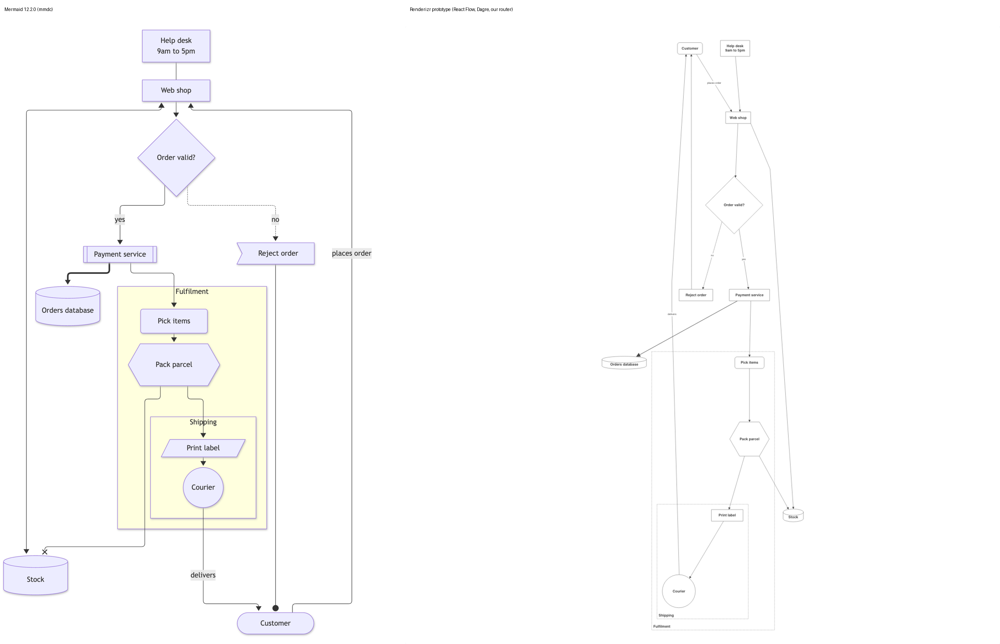
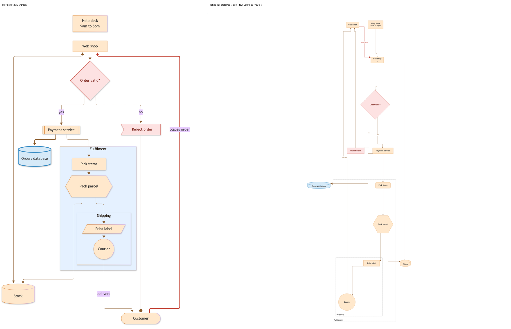

# Prototype: draw a flowchart from Mermaid source in the React Flow engine

A throwaway prototype that answers whether the React Flow engine can draw a Mermaid flowchart from its source well enough to commit to it. It lives on the branch `chore/179/mermaid-flowchart-prototype` and never merges.

## What it does

`loadWorkspace` calls `readMermaidDiagrams` (`scripts/mermaid/index.js`) before it inlines assets. For each image view whose content field starts with `<mermaid.url>/svg/` or `/img/`, the build decodes the source, parses it with Mermaid's own grammar and db class (`scripts/mermaid/parser.js`, generated by `research/179/build-parser.mjs` from the trimmed-parser harness on `chore/177/research-mermaid-parsing`, at `mermaid@12.2.0`), and replaces the image view with a **custom view of the same key**:

- Each node becomes a custom element tagged `Element,Mermaid`, with a link from `click … href` as its `url`.
- Each edge becomes a relationship tagged `Relationship,Mermaid`, with its label as the description.
- Each subgraph becomes a group (nested with `structurizr.groupSeparator`).
- The flowchart direction becomes the view's automatic layout `rankDirection`, so Dagre lays it out.
- Shapes, `classDef`, `style`, `linkStyle`, theme variables (`primaryColor`, `primaryBorderColor`, `primaryTextColor`, `lineColor`) and `curve` become implied tags with style definitions, most specific first: `style`, then `classDef`, then the config, then the workspace's tag styles, then the scheme defaults. The existing style cascade applies them.

The page changes by one line: `src/model/boundaries.ts` lets a custom view draw groups of custom elements.

Fixture: `test/__fixtures__/mermaid-flowchart.json`, exported by Structurizr 2026.09.19 from `test/__fixtures__/mermaid-flowchart/workspace.dsl`. Three image views carry the same 12-node graph: `plain` (silent source), `styled` (`%%{init}%%`, `classDef`, `style`, `linkStyle`, `click`) and `left-right`.

```bash
pnpm dev -- test/__fixtures__/mermaid-flowchart.json
```

## Side by side

Mermaid's own pictures come from `@mermaid-js/mermaid-cli` 12.0.0 with Mermaid pinned to 12.2.0 (`research/179/mermaid/`). Renderizr's come from `pnpm render … --single-file` driven in headless Chrome (`research/179/renderizr/`).

| Silent source | Styled source |
| --- | --- |
|  |  |

More: [left to right](179/renderizr/left-right.png), [dark](179/renderizr/plain-dark.png), [styled dark](179/renderizr/styled-dark.png), [styled dark, zoomed](179/renderizr/styled-dark-zoom.png), [plain without groups](179/renderizr/plain-nogroups.png).

## What works

- Every node, edge, edge label and nested subgraph draws, with no overlaps, in all four directions.
- Shapes read: rectangle, rounded, diamond, circle, cylinder, hexagon.
- The workspace's styles, font, color scheme, zoom and pan, drawer and title come for free, because the diagram is an ordinary view.
- From the source: the palette, `classDef`, `style` and `linkStyle` colors and widths, dotted and thick lines, `curve: step` as Orthogonal routing with avoidance, and `click … href` as a link activation target.

## What falls short

- **Height.** The plain view is about 5,400 units tall against Mermaid's compact picture. Dagre's compound graph adds ranks for each nesting level: the same view without groups is 2,565 units tall. Mermaid lays out each subgraph on its own and places it as one node. Text reads small at fit zoom as a result.
- **Edge ends.** The engine draws one filled arrowhead at the target. Open lines (`---`), bidirectional (`<-->`), circle (`--o`) and cross (`--x`) ends all draw as a plain arrow. The ERD's crow's foot ends need the same missing piece.
- **Edges to subgraphs** (`A --> SubgraphB`) are dropped, as edges to boundaries are today.
- **Text color under a source palette.** `primaryColor` alone leaves the text at the scheme's color, so light text sits on a light fill in dark mode. Mermaid derives `primaryTextColor` and the rest from `primaryColor`; the build needs Mermaid's theme code, about 8 kB gzipped, build-side only.
- **Node size.** The build has no text measurement, so it estimates each label's box from an average glyph width. The page measures text already; a real build would size nodes there.
- **Groups.** Subgraphs draw as plain dashed groups. `clusterBkg`, `clusterBorder` and the implied `Mermaid` tag don't reach them.
- **Custom view side effects.** The drawer shows a custom view's icon, edit mode would offer to arrange it (the map wants it read-only), and every node adds a style definition (44 for three small diagrams). A real build would mark the view as a Mermaid diagram and carry per-node style overrides instead of per-node tags.

## Cost

| | Size |
| --- | --- |
| Page code | One table entry in `src/model/boundaries.ts` |
| Build code: converter | 323 lines (`scripts/mermaid/index.js`) |
| Build code: generated parser | 331 kB unminified, 70 kB gzipped; all three types, never in the page |
| Parse time | 8 ms to import, about 1 ms per diagram |
| Workspace in the page | 3 kB before, 23 kB after for three 12-node diagrams (about 7 kB per diagram, before gzip) |
| Single-file page | 880 kB, inside the build test's budget |

## Syntax

Covered: `flowchart` / `graph`, `TB` / `TD` / `BT` / `LR` / `RL`, the shapes listed above, labels with `<br>`, `-->`, `-.->`, `==>` with `|label|` or `-- label -->`, nested `subgraph`, `classDef` / `class`, `style`, `linkStyle`, `click … href`, `%%{init}%%` and frontmatter config, `nodeSpacing` / `rankSpacing`, `curve`.

Falls back with a warning: stadium and subroutine (drawn rounded and plain), asymmetric `>]`, parallelogram and trapezoid, `@{ shape }` names outside the list, double circle (drawn as a circle), open, circle, cross and bidirectional edge ends.

Left out: edges to subgraphs, a subgraph's own `direction`, edge length (`--->`), invisible links (`~~~`), Markdown strings, `fa:` icons, `click` callbacks, `look`, `htmlLabels`, `layout: elk`, group styling.

## What it teaches about ERDs and sequence diagrams

- **ERDs** reuse almost all of it: Dagre, the router, the style cascade and the build conversion. They need two pieces of page code a flowchart also wants: an entity shape with attribute rows (an outline plus a label template of its own) and an edge-end module (crow's foot ends, and the flowchart's open, circle and cross ends).
- **Sequence diagrams** reuse the canvas, styles, zoom, pan and the animation steps, since a message list resembles a dynamic view's ordered relationships. Nothing else carries over: no Dagre, no router, and lifelines, activations and fragments don't fit as elements and relationships. They need their own layout and node types in the page.
