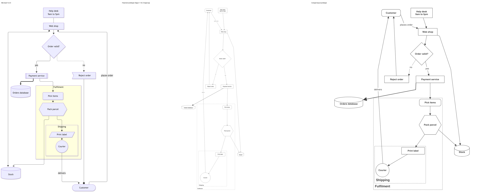
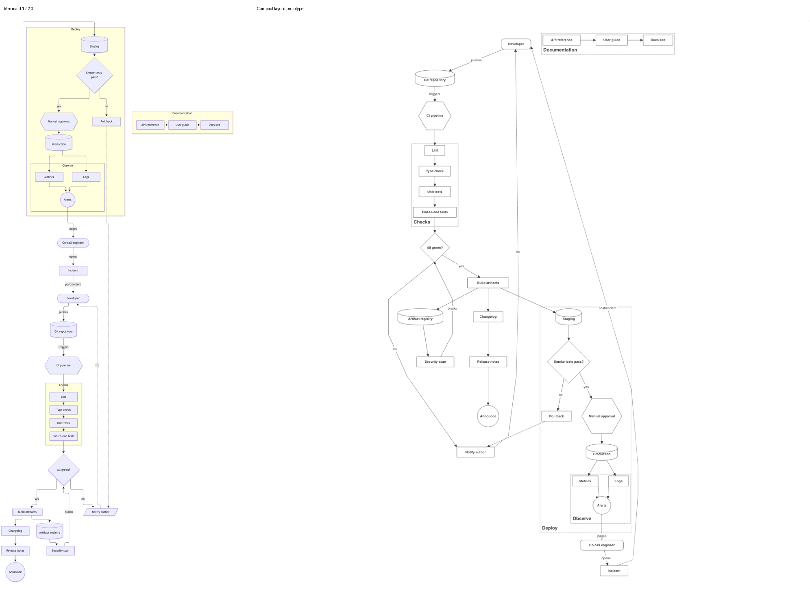
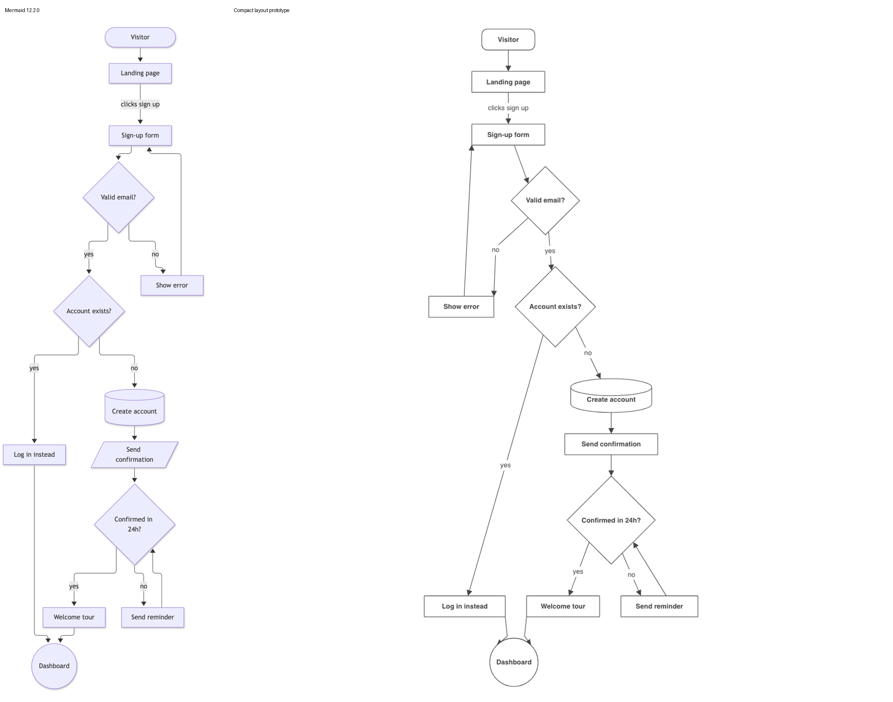
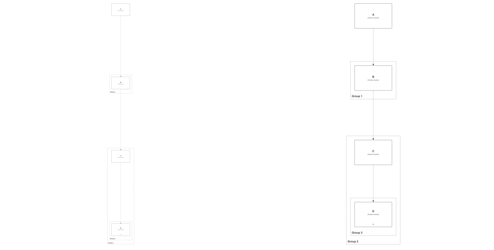

# Prototype: lay out a Mermaid diagram as compactly as Mermaid

A throwaway prototype that finds why the engine draws a Mermaid flowchart about four times as tall as Mermaid does, and what brings it in line. It lives on the branch `chore/184/mermaid-compact-layout`, cut from the flowchart prototype's branch, and never merges.

## Result

Four changes, all limited to Mermaid diagrams, bring every fixture view within 1.25 times Mermaid's own size, measured in units of each picture's font size (Mermaid draws at 16 px, Renderizr at 24 px):

| View | Mermaid | Changes 2–4 on Dagre 1.1.8 | All four changes |
| --- | --- | --- | --- |
| Order flow (two nested subgraphs) | 53 × 86 | 59 × 164 | 59 × 80 |
| Release pipeline (about 30 nodes, four subgraphs) | 80 × 193 | 83 × 354 | 83 × 164 |
| Sign-up (no subgraphs) | 32 × 102 | 40 × 96 | 40 × 96 |
| Order flow, left to right | 138 × 36 | 201 × 38 | 116 × 38 |

| Order flow | Release pipeline | Sign-up |
| --- | --- | --- |
|  |  |  |

Mermaid's pictures come from `@mermaid-js/mermaid-cli` with Mermaid pinned to 12.2.0 (`research/184/mermaid/`, and `research/179/mermaid/` for the order flow). Renderizr's come from `pnpm render … --single-file` driven in headless Chrome (`research/184/renderizr/`).

## The four changes

1. **Dagre without the empty-rank bug.** This is most of the height. Dagre 1.1.8's `removeEmptyRanks` takes the minimum rank over every node, boundaries included. A boundary has no rank, so the minimum is `NaN` and Dagre removes none of the empty ranks its nesting graph adds around boundaries. Each one still adds a rank separation. Dagre 2.0.1 filters out nodes without a rank, and Mermaid's fork (`dagre-d3-es` 7.0.14) never had the bug, because lodash's `_.min` skips `undefined`. On the order flow graph alone: Dagre 1.1.8 lays it out 152 font sizes tall, Dagre 2.0.1 to 3.1.1 and Mermaid's fork 68 (3.1.1 gives 77), and all of them 65 without boundaries. The prototype adds Dagre 2.0.4 under the alias `dagre-2` and uses it for Mermaid diagrams only.
2. **Mermaid's subgraph rule.** A subgraph no edge crosses gets its own Dagre run, placed as one node of the graph around it, in the flipped direction (TB becomes LR) unless it sets `direction`, with rank separation plus 25 (scaled). Every other subgraph stays in the compound graph. The fixture's "Documentation" subgraph lays out left to right on its own, as in Mermaid.
3. **Mermaid's spacing, scaled to the font.** Separations 50/50/20 become 75/75/30, and a source's `nodeSpacing` and `rankSpacing` scale the same way. Group padding drops from 50 to 12 (Mermaid's 8, scaled), in the derived boundary and in the pass that pushes neighbors apart.
4. **Label room and node size from the label.** An edge reserves the room its label needs, none when it has no label, in place of 1.2 times the wrap width on every edge. A node is its label plus 30 on each side and 15 above and below, scaled. A diamond's side is the label's width plus its height plus padding, and a circle fits the label's width plus padding, as Mermaid's shapes do.

## Cost

- A second Dagre for Mermaid diagrams costs about 15 kB gzipped, about 11% of the island. Moving every view to Dagre 2.0.4 costs about 0.8 kB more than 1.1.8.
- The subgraph rule adds about 120 lines to `src/engine/layout/automatic.ts`, and the spacing switches about 40 lines in `src/engine/react-flow/graph.ts` and `src/engine/geometry/boundary.ts`.

## What the fix does to C4 views

Dagre 2.0.4 leaves widths alone and shortens every grouped automatic layout. Measured on the fixtures:

| View | Dagre 1.1.8 | Dagre 2.0.4 |
| --- | --- | --- |
| `groups.json`, SystemLandscape | 650 × 5,911 | 650 × 2,911 |
| `groups.json`, Containers | 1,350 × 2,339 | 1,350 × 1,439 |
| `cyclic-groups.json`, CyclicGroups | 13,303 × 15,143 | 13,303 × 9,143 |

[4. Use Dagre for automatic layout](../architecture/decisions/0004-use-dagre-for-automatic-layout.md) pins Dagre 1.1.8 and keeps "today's look, quirks included". The empty ranks are one of those quirks.

## Left over

- Group titles draw at the C4 group size, larger than node text. Groups don't take the implied `Mermaid` tag yet, so `element "Mermaid"` and the Mermaid font size don't reach them.
- Node sizes come from an average glyph width in the build. The page's own text measurement replaces that in the spec.
- Edges still cross groups where Mermaid routes around them; the router's avoidance treats only elements as obstacles.
