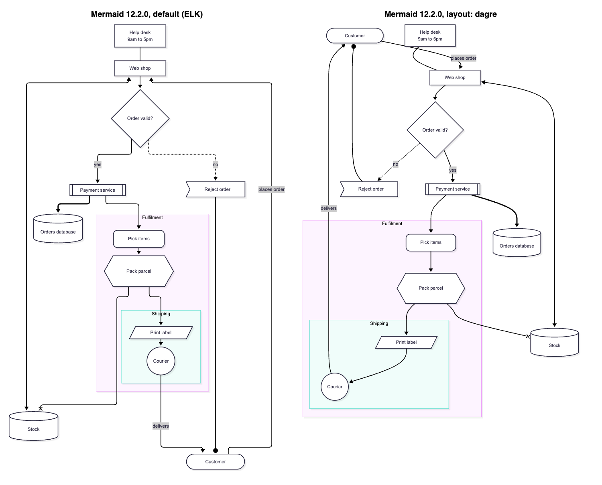
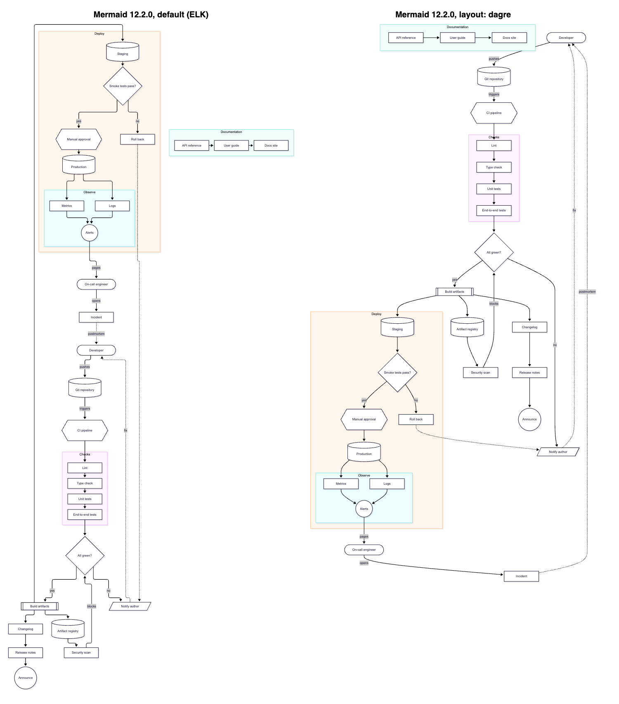

# The graph Mermaid hands Dagre for a flowchart

Mermaid 12.2.0 lays out flowcharts with ELK by default, so its pictures come from ELK and the graph it hands Dagre never runs. Mermaid's own config sets `layout: "elk"` at the top level from 12.0.0 on; Mermaid 11 (up to 11.17.2) defaults to `"dagre"` and bundles no ELK. With `layout: dagre`, Mermaid 12.2.0 puts Customer at the top of the order flow, exactly as Renderizr's Dagre does.

## How we measured

- Mermaid 12.2.0 (its IIFE bundle, `dist/mermaid.js`) runs in headless Chrome through `puppeteer-core`. A patched copy records every graph `layout()` in `dagre-d3-es` receives, before and after the run, and the nodes and edges `FlowDB.getData()` hands the layout ([capture.mjs](186/capture.mjs)). The patch wraps `layout(g, opts)` in the bundle and adds one line to `prepareLayoutForDagre`; the bundle itself stays out of the repo.
- A log line in Mermaid's `render` showed the layout algorithm: `elk` for every fixture, with no config in the source.
- With `mermaid.initialize({ layout: "dagre" })`, the patch captured the Dagre input for the four fixtures of the compact layout prototype: order flow, order flow left to right, sign-up and release pipeline ([dagre-input.json](186/dagre-input.json)).
- [replay.mjs](186/replay.mjs) feeds each captured graph to Dagre 2.0.4 in the same node and edge order, with the same widths, heights, `minlen` and label sizes.

## What Mermaid hands Dagre

On the order flow, one Dagre run with `rankdir: TB`, `nodesep: 50`, `ranksep: 50`, `marginx: 8`, `marginy: 8`. Nodes go in `FlowDB.getData()` order (subgraphs first: `fulfilment`, `shipping`, then `customer`, `shop`, `valid`, `payment`, `reject`, `orders`, `pick`, `pack`, `label`, `courier`, `stock`, `help`), and edges go in source order. `adjustClustersAndEdges` and `extractor` change nothing here, because edges cross both subgraphs. Every edge has `minlen` 1, no `weight`, `labelpos` `c` and its label's measured size (0 × 0 without a label).

Dagre 2.0.4 fed those graphs places every leaf node at the same coordinates as `dagre-d3-es` 7.0.14, to the pixel, on all four fixtures, including the release pipeline's extracted subgraph (two Dagre runs). Mermaid's Dagre layout holds no ordering rule Renderizr lacks.

## What ELK does differently

Mermaid's ELK root graph uses `elk.layered` with the `default` preset: `NETWORK_SIMPLEX` layering, `BRANDES_KOEPF` placement with `BALANCED` alignment, `DEPTH_FIRST` cycle breaking, `INCLUDE_CHILDREN` hierarchy handling, `spacing.baseValue` 40 and orthogonal edges. A source can pick another preset (`legacy` uses `GREEDY` cycle breaking) or set each option under `elk`.

ELK's depth-first cycle breaker starts from the sources (nodes with no incoming edge). In the order flow, Help desk is the only source, so the search runs Help desk, Web shop, … Courier, Customer, and reverses "places order" (Customer to Web shop). Dagre's depth-first acyclic pass starts from the first node in insertion order, Customer, and reverses "delivers" instead.

| Fixture | Dagre, model order | Dagre, sources first | Mermaid ELK |
| --- | --- | --- | --- |
| Order flow (top rank → bottom rank) | Customer and Help desk at the top, Courier at the bottom | Help desk at the top, Customer at the bottom | Help desk at the top, Customer at the bottom |
| Sign-up | same as ELK's order, fewer ranks | unchanged | one node per rank in places |
| Release pipeline | Developer at the top, subgraphs in the flow | unchanged | the Deploy subgraph at the top, Developer and the rest of the flow below it |

"Sources first" means Renderizr hands Dagre the nodes with no incoming edge first, in model order, then the rest ([sources-first.mjs](186/sources-first.mjs)). It moves the order flow's cycle break to where ELK puts it and changes nothing on the other fixtures. ELK still layers and places nodes its own way: one node per layer where Dagre shares a rank, and on the release pipeline a different arrangement of whole subgraphs. No ordering rule in front of Dagre reproduces that.

## What matching Mermaid would cost Renderizr

- **Mermaid's Dagre layout** (`layout: dagre` in the source, and every Mermaid 11 picture): nothing. Renderizr already matches it once it feeds Dagre `FlowDB.getData()` order with Mermaid's sizes, as the compact layout prototype does.
- **The cycle direction of Mermaid's ELK layout**: an ordering rule in the build, putting sources first. A few lines, no new dependency. It fixes which edge points back up, and nothing else about ELK's picture.
- **Mermaid's ELK layout itself**: ELK. `elkjs` 0.9.3, the version Mermaid bundles, weighs about 3.4 times the page's whole React Flow island gzipped (its 0.11 line is larger still). It would be a second layout engine beside Dagre, which [4. Use Dagre for automatic layout](../architecture/decisions/0004-use-dagre-for-automatic-layout.md) makes the one engine for automatic layout, and Mermaid's ELK options (presets, `spacing.baseValue`, port margins) would need porting too. Running ELK in the build instead would need node sizes there, where the page measures text today.

## Left over

- Which picture an author compares against depends on the Mermaid version behind the workspace's `mermaid.url`: a Mermaid 11 server draws with Dagre, a Mermaid 12 server with ELK, unless the source sets `layout`.
- A source's own `layout` (`dagre`, `elk`) and `elk` options have no decision yet: Renderizr could honor `layout: dagre` exactly and approximate `elk` with the sources-first rule.
