# Prototype: draw an ERD entity collapsed and expanded

A rough ERD in the React Flow engine, to react to how an entity looks and behaves collapsed and expanded. This branch builds on `chore/184/mermaid-compact-layout` and never merges.

## Run it

```bash
pnpm dev -- test/__fixtures__/mermaid-erd.json
```

Open the **Shop** or **Shop, left to right** view. Add `?entity-motion` before the hash to ease entities to their new places on a toggle.

## What the prototype does

- **Fixture**: `test/__fixtures__/mermaid-erd.json` carries `mermaid-erd/shop.mmd` (six entities: composite keys, an entity with no key attribute, one with no attributes, every cardinality) as `shop` and, with `direction LR`, as `shop-lr`. Structurizr isn't installed here, so the JSON is hand-built the way Structurizr encodes `content`; `workspace.dsl` shows the source it stands for.
- **Build** (`scripts/mermaid/index.js`, `readErd`): each entity becomes a custom element tagged `Mermaid:entity` that carries its attributes as JSON in a property; each relationship carries its start and end markers in two properties and draws dashed when non-identifying. Mermaid names an edge's cardinalities backwards (`cardA` sits at entity B), which the build undoes.
- **Page** (`src/engine/geometry/entity.ts`, `graph.ts`): the page sizes an entity from its header and the rows its state shows, with its own text measurement, before Dagre runs. A collapsed entity shows its `PK` and `FK` attributes by name and keys; an expanded one adds the type column, the `UK` and keyless rows and, with descriptions on, the comment column. The name column takes whatever width the header leaves over.
- **Island** (`island.tsx`): an entity draws as a box node with an HTML header and a row per attribute. The chevron is a real button with `aria-expanded`. Chevron overrides live in the canvas, for the view and the preference they were made under. A chevron click pans so the entity's header keeps its place on screen.
- **Toolbar** (`current-view.ts`): "Expand all" / "Collapse all" shows on a view the build marks as an ERD, and stores `entitiesCollapsed` beside the label toggles.
- **End markers**: one, zero or one, one or more and zero or more, drawn as strokes at each end, with hollow circles filled with the canvas background. They replace the arrowhead.

## Pictures

| | Light | Dark |
| --- | --- | --- |
| Collapsed (first visit) | 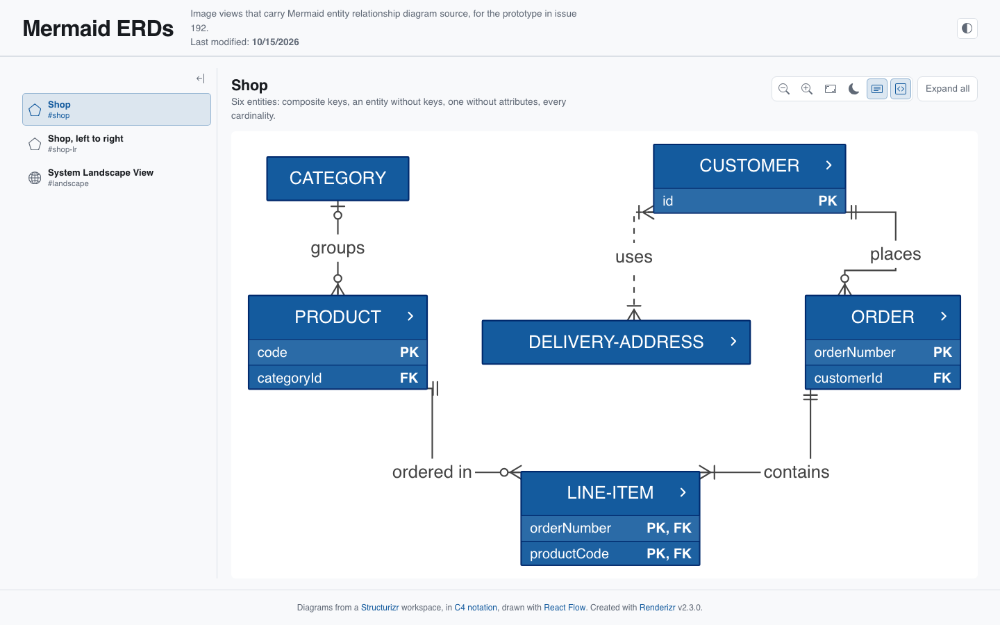 | 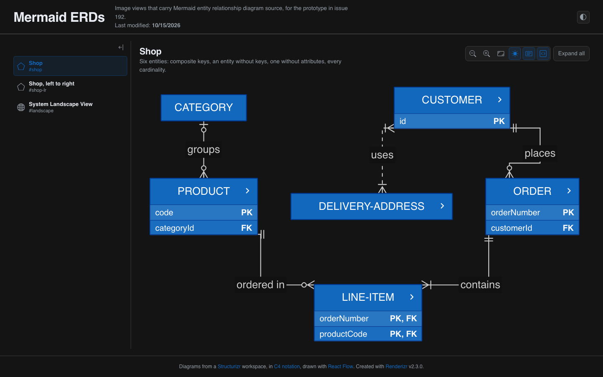 |
| Expanded (Expand all) | 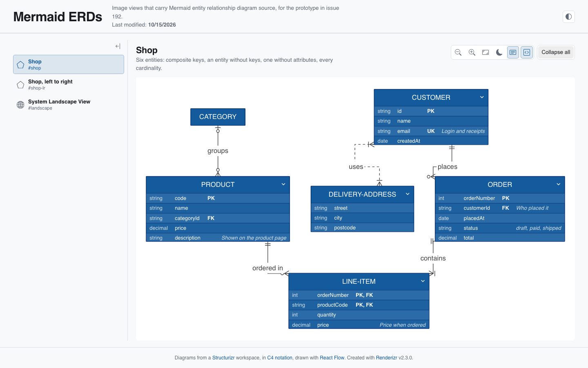 | 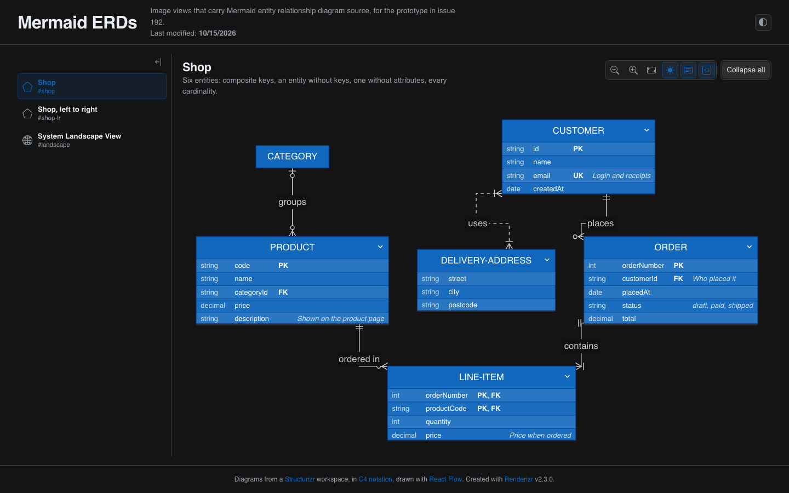 |
| Expanded, ORDER collapsed by its chevron | 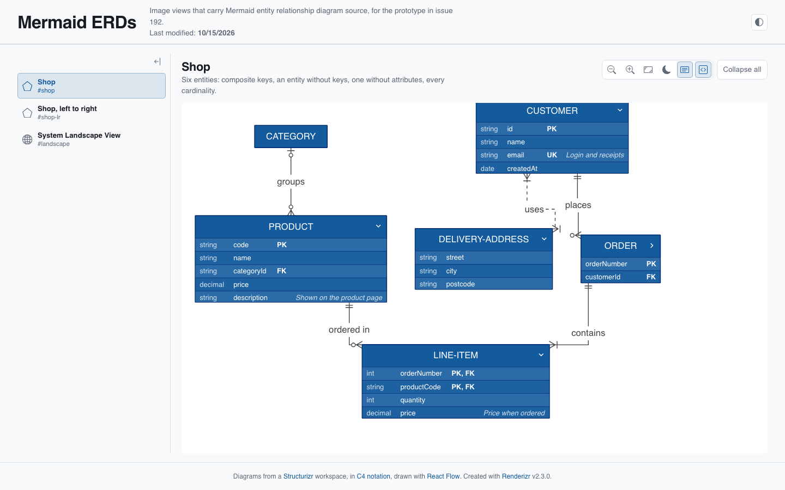 | 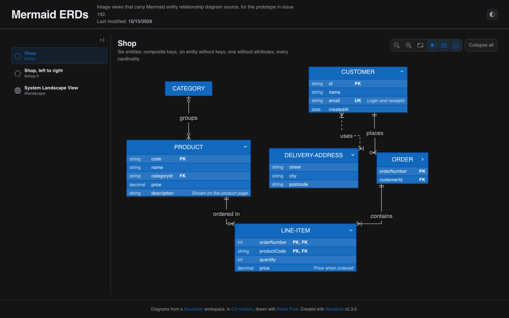 |
| Collapse all after a chevron click | 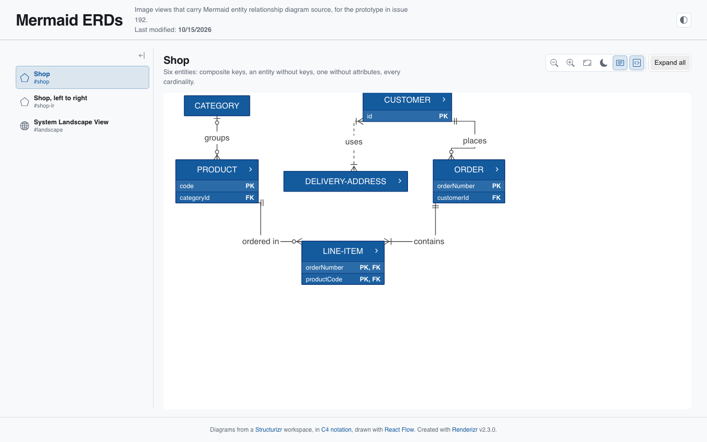 | 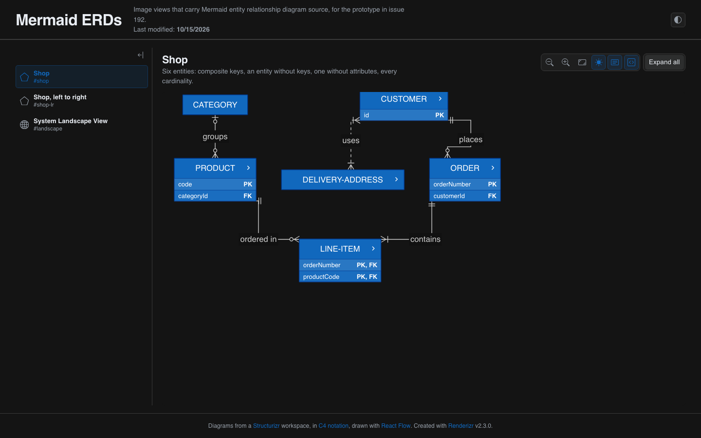 |
| Left to right, collapsed | 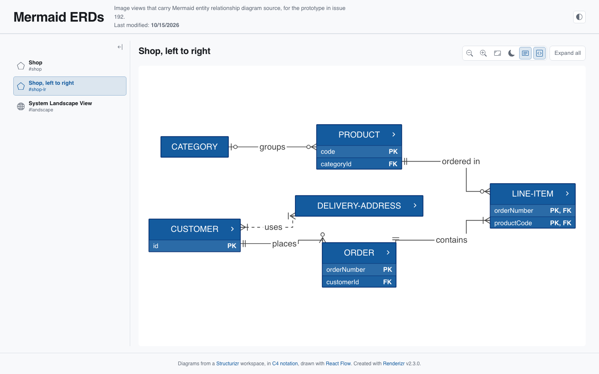 | 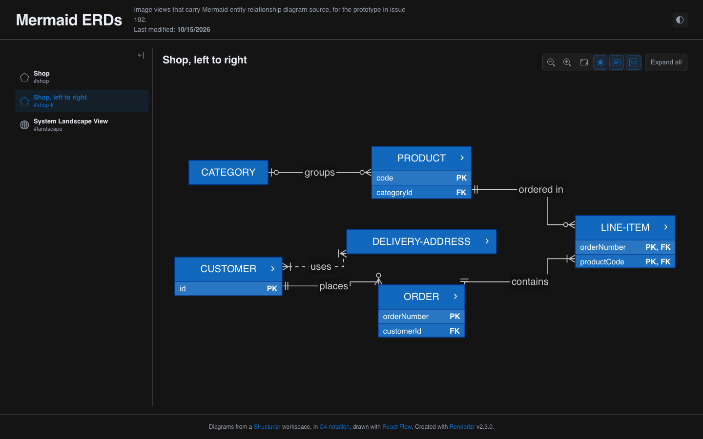 |
| Left to right, expanded | 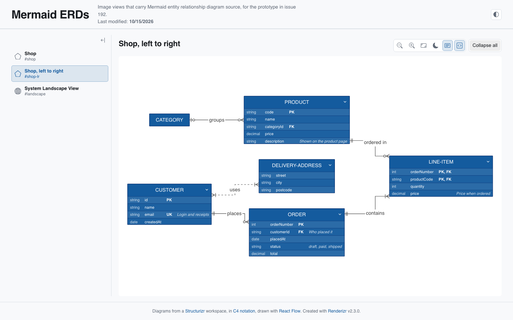 | 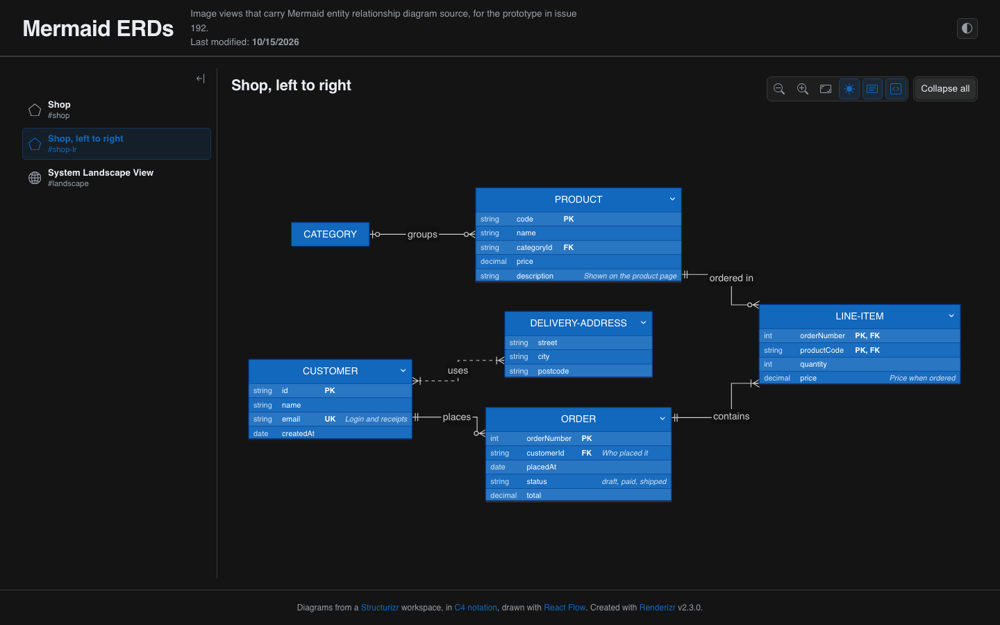 |

## Findings

- **The entity fits the engine.** The geometry modules take an entity as a Box of the size the page computes; the router, edge labels and the style cascade need no change. The silent source's primary fill carries over from the compact layout prototype.
- **Sizing belongs to the page.** The size depends on the state, the descriptions toggle and the font, so only the page knows it, as the flowchart prototype found for nodes.
- **The pan holds.** On a chevron click, the header's screen position stays the same to the pixel in both schemes (1066, 432 before and after). The rest of the diagram rearranges around it.
- **Collapse all after a chevron click doesn't refit.** The chevron marks the viewport as moved, so the toolbar button keeps it, and a diagram that grows or shrinks can leave entities off screen (CUSTOMER clipped at the top). The label toggles behave the same way today.
- **The jump.** Dagre rerunning reorders more than the toggled entity: neighbors swap sides and edges reroute. Easing node positions (`?entity-motion`) moves the boxes but not the edges, which the router draws at their final place at once.
- **An entity with no key attribute** collapses to its header and keeps a chevron, which reads well (DELIVERY-ADDRESS). An entity with no attributes draws no chevron (CATEGORY).
- **End markers on changing heights.** Markers stay on the outline as entities grow and shrink. Two ends that share a side crowd each other (CUSTOMER's `uses` and `places`), which the spacing rule from the edge ends decision covers and this prototype leaves out.
- **Rows** read in both schemes on the primary fill. Alternating rows use a white overlay, which works on a dark fill only; a light source palette needs another rule.

## Left out

Entity styling from `style` and `classDef`, entity aliases with brackets, attribute keys spaced along shared sides, keyboard focus order for chevrons, export, edit mode.
