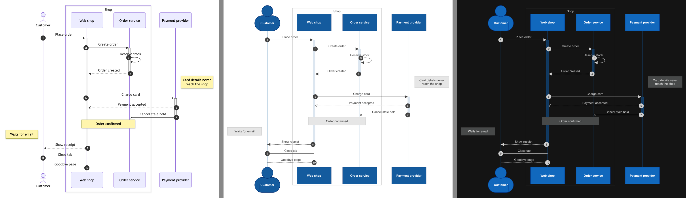
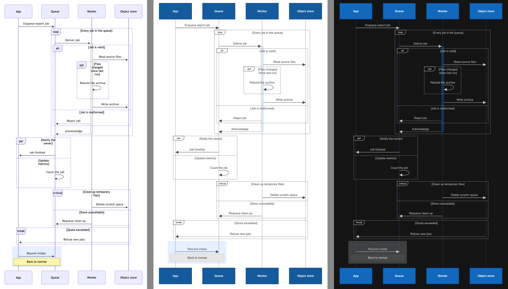
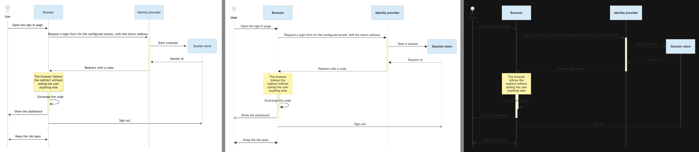
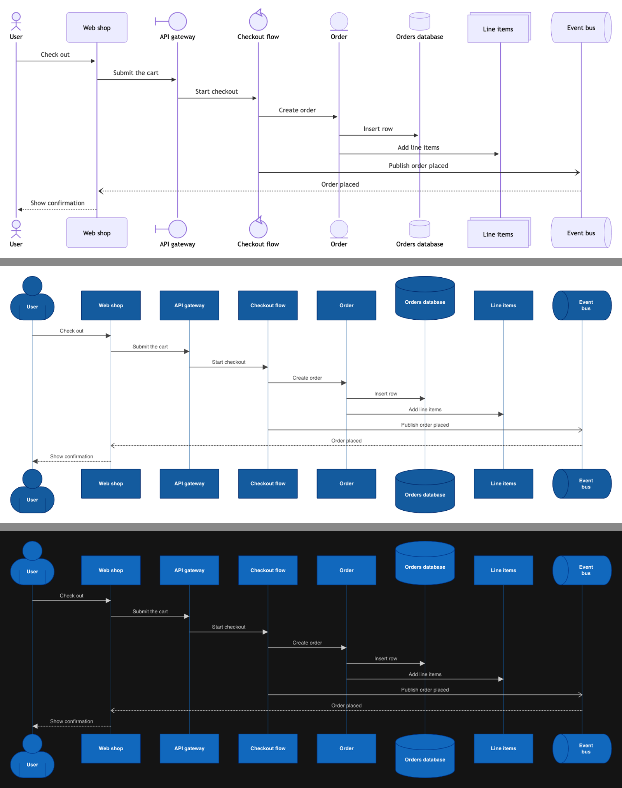

# Prototype: draw a sequence diagram in the React Flow engine

A rough sequence diagram in the React Flow engine, laid out by our own code, to react to how it draws, styles and exports. This branch builds on `chore/192/erd-entity-prototype` merged with `main` (for export and Dagre 2.0.4), takes the fixtures from `chore/195/sequence-layout-research`, and never merges.

## Run it

```bash
pnpm dev -- test/__fixtures__/mermaid-sequence.json
```

Open **Checkout**, **Export retry**, **Sign-in** or **Participant shapes**, in either color scheme.

## What the prototype does

- **Build** (`scripts/mermaid/index.js`, `readSequence`): each participant becomes a custom element tagged `Element`, `Mermaid`, `Mermaid:participant` and its type (`actor` draws as C4's `Person`, `database` as `Cylinder`, `queue` as `Pipe`), and each message a relationship tagged `Relationship`, `Mermaid` and Solid or Dotted by its arrow. The view carries a script in `renderizr.mermaid.sequence`: participants in order, boxes, `create` / `destroy` indices, `mirrorActors`, `rightAngles`, the source's sequence palette (absent for a silent source) and Mermaid's flat list as items (messages with their start and end markers, notes, activations, fragment opens, sections and closes, `autonumber`). Named themes take the variables the research measured; `base` derives them from `primaryColor` with khroma's math, and the sign-in fixture matches Mermaid to the hex digit. The parser's box color check read `window.CSS`, so the build has a stand-in (a CSS color function or a named color).
- **Layout** (`src/engine/geometry/sequence.ts`, `layOutSequence`): a pure function over the script and the participant widths the page measured. One pass with a cursor, an activation stack per participant and a fragment stack, Mermaid's constants scaled by 1.5. A first pass finds each fragment's width; the second wraps fragment titles to that width minus the tab. No Dagre, no router.
- **Graph** (`src/engine/react-flow/sequence-graph.ts`): `drawView` builds element boxes and edge drafts as for any custom view, then hands them to `finishSequence` in place of `positionElements`, `routeView` and label placement. Participants stay `ElementBox`es (a footer copy gets the id `<id>#footer`); messages stay `EdgeLine`s with a fixed route, path, end markers and an unbacked label. Everything else goes into a new `graph.sequence` layer. An actor draws C4's Person at its own square proportions (1.5 times the row), and a database a Cylinder 1.5 times the row tall at its column's width, since the Cylinder's fixed lid left a row-high body squashed. Both stand on the header row and hang from the footer row, so every lifeline starts on one line.
- **Island** (`island.tsx`): one `sequence` node type, drawn twice: a back layer under the edges and a front layer over them (notes, central connection dots, sequence numbers). The back layer draws boxes, `rect` fills, lifelines, activation bars, then the other fragments, so fragment and section titles sit above the bars.
- **Export** (`export-svg.ts`): the serializer draws the same two layers around the edges, and now draws stroked end markers (crosses, open arrows) too.

## Pictures

Mermaid 12.2.0 with Structurizr's payload (`theme: default`), then Renderizr in light and dark. Each picture is scaled to the same height.

| Fixture | Mermaid, Renderizr light, Renderizr dark |
| --- | --- |
| Checkout |  |
| Export retry |  |
| Sign-in (`theme: base`, `primaryColor`) |  |

Participant shapes, stacked: Mermaid, then Renderizr in light and dark.



Full-size pictures sit next to these in `research/197/`.

## Measured

Content size in model units against Mermaid's `classic` picture without its margins, scaled by 1.5:

| Fixture | Renderizr | Mermaid × 1.5 | Ratio |
| --- | --- | --- | --- |
| Checkout | 1456 × 1234 | 1455 × 1268 | 1.00 × 0.97 |
| Export retry | 1125 × 1947 | 1127 × 2270 | 1.00 × 0.86 |
| Sign-in | 1666 × 998 | 1736 × 1020 | 0.96 × 0.98 |

Every fixture sits within the 1.25 the flowcharts reached. Text draws at 20 (Mermaid's 16 scaled by 1.25) and participant names at 14 times the name scale, a little smaller than the 1.5 every other length scales by; the first pass at 24 read large. Participants keep the C4 label template, which pads a name by 30 on each side where Mermaid pads by 15 scaled.

## Findings

- **Layout**: Mermaid's geometry reproduces in about 600 lines of pure code. Columns, message pitch, self-message loops, stacked activation bars, notes on every side, nested fragment padding and `box` margins all land where Mermaid puts them.
- **Engine fit**: participants and messages reuse `ElementBox` and `EdgeLine` with no change to the edge component; the style cascade reaches them through their tags. Nothing in the geometry modules or the router needed a branch: a sequence diagram skips them. What's new is a graph field (`sequence`) and one node type in two layers. The build still rewrites the image view into a custom view, as every Mermaid prototype has; the view-type design from the flowchart prototype stands, and its resolved view needs a slot for the script.
- **`create` / `destroy`**: confirmed. A created participant's box centers on the creating message's line, the message stops at its edge, and the lifeline starts below it. A destroyed participant's lifeline ends at the destroying message, with no cross added. Mermaid moves down half a row after a destroying message with or without the footer, and so does the prototype.
- **`mirrorActors: false`**: confirmed. Every lifeline ends 30 below the last item.
- **Drawing order**: activation bars belong behind the messages and the fragment titles; drawn in front, they cover the titles. Message labels draw with no backing, as Mermaid's: a backing hid the bars and fragment lines under a label.
- **Sequence numbers**: Mermaid 12's circle measures about 11 at 16 px, where its source reads 6, so the prototype scales 11.
- **Silent lifelines and bars**: the participant's border color nearly disappears on the dark canvas, so a silent source's lifelines take the participant's fill. A silent source's activation bars take the participant's fill mixed toward the canvas, 85 percent on the light canvas and 55 percent on the dark one, with a border mixed less; one mix for both schemes left the bar too heavy in one of them. A silent source's notes draw gray in both schemes (`#e6e6e6` on light, `#474949` on dark) in place of Mermaid's yellow.
- **A source palette in dark mode**: with the palette fixed in both schemes, Sign-in's `#333` messages and labels nearly vanished on the dark canvas. Fills keep the source's colors (participants, notes, activation bars, the fragment tab); in dark mode, what draws straight on the canvas follows the scheme (message lines and labels, sequence numbers, lifelines, fragment lines and titles). A `rect` with a source color fades to 20 percent in dark mode, so the scheme's text reads on it.
- **Label toggles**: drawn as they are. Descriptions hide nothing, since participants carry no description and messages keep theirs; technologies hide nothing either.
- **Participant shapes**: an actor draws as C4's Person, `database` as `Cylinder` and `queue` as `Pipe`. The Pipe's content area is narrow, so a two-word name such as "Event bus" wraps. `boundary`, `control`, `entity` and `collections` fall back to the participant box and warn, where Mermaid draws its own symbols: a circle with a bar, a circle with an arrowhead, a circle on a line, and stacked boxes.
- **Export**: the PNG and SVG buttons export what the canvas draws, lifelines, bars, fragments, boxes, notes and numbers included.

## Left out

Participant names in Mermaid's weight (the C4 template draws them bold), `redux-color` per-participant arrays, central connection activations, half arrows beyond their fallback markers, Mermaid's title-wrap quirk, keyboard focus, edit mode, the view type in place of the custom view rewrite.
