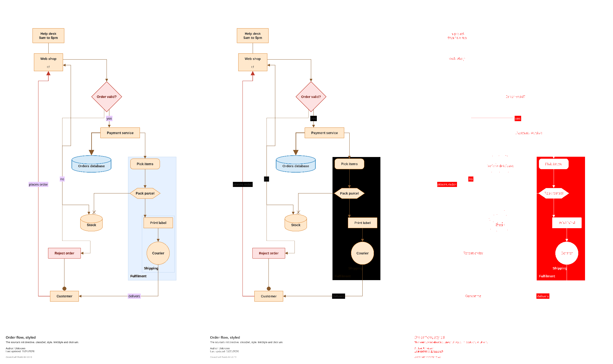

# Prototype: export every view kind from Node with a parity test

Throwaway code for [Prototype: export every view kind from Node with a parity test](https://github.com/FormulaMonks/renderizr/issues/360), part of the map [Map: export views as SVG or PNG from the CLI](https://github.com/FormulaMonks/renderizr/issues/356). Nothing here ships.

## What it does

- `chrome.mjs` builds each fixture as a single file with `--font Arimo` and `--font Inter` in a report build (`RENDERIZR_ENGINE_REPORT=1`), opens every view in headless Chrome and saves the toolbar's own SVG and PNG through the `renderizrExportView` hook: the full view, every animation step and, for two fixtures, dark.
- `driver.ts` does what the engine's `exportView` does (`buildGraph`, `stepStateOf`, `exportFrame`, `titleBlockText`, `exportSvg`), bundled for Node with esbuild.
- `node.mjs` exports the same cases in Node. It fetches the faces with `loadFont`, instances them at 400 and 700 (`instance.mjs`, from [Prototype: hand resvg static regular and bold faces](https://github.com/FormulaMonks/renderizr/issues/359)), measures with fontkit and rasterizes with `@resvg/resvg-js`. `RULE=chrome` copies Chrome's ascent and descent; `RULE=file` reads them from the face's `hhea` table, unrounded. It then compares each pair: the SVG without its `<style>` (byte for byte, then text line by line and every number outside the text), the PNG size, the share of pixels apart, the pixels apart inside the bold lines' boxes against an export with bold taken out, and whether two runs write the same bytes.
- `summarize.mjs` folds the results into the tables below.

```bash
npm install
../../node_modules/.bin/esbuild driver.ts --bundle --platform=node --format=esm --outfile=driver.mjs --define:__RENDERIZR_EDIT_MODE__=false --define:__RENDERIZR_ENGINE_REPORT__=false --define:__RENDERIZR_VERSION__=null
node chrome.mjs
RULE=chrome node node.mjs
RULE=file node node.mjs
node summarize.mjs
```

## Results

294 toolbar exports across `export`, `view-types`, `perspectives`, `animation`, `mermaid-flowchart`, `mermaid-erd`, `mermaid-sequence` and `mermaid-styles`, each in Arimo and Inter. Measured on macOS arm64 with Node 26.12 and Chrome 157.

| Fixture                                  | Exports per font | SVG, Chrome's metrics               | Text shift, file metrics     | PNG pixels apart (max)  | Bold kept                  |
| ---------------------------------------- | ---------------- | ----------------------------------- | ---------------------------- | ----------------------- | -------------------------- |
| export (C4, dynamic, dark)               | 8                | identical                           | 0.11 px Arimo, 0.04 px Inter | 0.90%                   | all                        |
| view-types (landscape, filtered, custom) | 3                | identical                           | same                         | 0.43%                   | all                        |
| perspectives                             | 4                | 3 identical, 1 box 0.07 px wider    | same                         | 0.43%                   | all                        |
| animation (every step)                   | 15               | identical                           | same                         | 0.33%                   | all                        |
| mermaid-flowchart                        | 10               | identical                           | same                         | 6.71% (one view)        | all but that view in Inter |
| mermaid-erd                              | 3                | identical                           | same                         | 0.51%                   | all                        |
| mermaid-sequence (every step, dark)      | 99               | identical                           | same                         | 0.91%                   | all                        |
| mermaid-styles                           | 5                | 4 identical, `fonts` laid out apart | same                         | `fonts` differs in size | all                        |

- **Under the same metrics, Node writes the toolbar's SVG.** 290 of 294 exports are byte-identical outside the `<style>` block, every line breaks at the same place and every text sits at the same position.
- **The ascent and descent rule.** Chrome's `fontBoundingBoxAscent` rounds to whole pixels at 100 px: 0.91 and 0.21 for Arimo, against 0.9053 and 0.2119 in its `hhea`; 0.97 and 0.24 for Inter, against 0.9688 and 0.2412. `hhea` and `OS/2` typo agree for both faces, and neither sets `USE_TYPO_METRICS`. Reading `hhea` unrounded moves every text by at most 0.11 px (Arimo) and 0.04 px (Inter) against today's toolbar export, and changes nothing else.
- **The PNG matches in size once it is stretched like the page's canvas.** resvg's `fitTo` rounds the height up (4570 by 3671 against Chrome's 3670). Setting the SVG's `width` and `height` to `pngSize` with `preserveAspectRatio="none"` gives the same size every time.
- **Bold stays bold.** Inside the bold lines' boxes, Node sits 4% to 16% of pixels away from Chrome; drawn without bold it sits 17% to 33% away. The one miss is the flowchart below, in Inter.
- **Two runs write the same bytes**, SVG and PNG, for every export.
- **An export takes 50 to 610 ms**, measuring and rasterizing included.

## Gaps

- **resvg draws `hsl()` with a fractional hue black.** Mermaid's theme math writes colors such as `hsl(212.9411764706, 100%, 95%)`; resvg 2.6.2 reads `hsl(272, 100%, 90%)` and a negative hue, but not a decimal one. In `mermaid-flowchart`'s `styled` view the subgraph and edge-label fills come out black (6.7% of pixels). 21 of 294 exports carry such a color, most of them as thin strokes that stay under 1% of pixels, so a pixel tolerance alone misses it.

  

- **A family the Mermaid source or a node names is the reader's system font.** `mermaid-styles`' `fonts` view sets `fontFamily: Georgia, serif` and one node `font-family: Courier New`. Chrome measures them in the installed fonts; Node has only the `--font` faces, so it measures in Arimo or Inter and lays the view out apart (609 by 1244 against 628 by 1251). With `loadSystemFonts: false` resvg also draws them in the `--font` face.
- **A box measured by its label is off by a fraction of a pixel.** In `perspectives`' `Containers`, an edge label box is 121.88 px wide in Node against 121.81 px in Chrome: fontkit's width is 0.07 px wider than `measureText`. Text positions still match.
- **Only light and dark in one locale.** Every case runs with the page's default labels, no perspective, `en-US` dates and the build date the page fell back to, read off the toolbar's title block.

Nothing ran on Linux or Windows.
