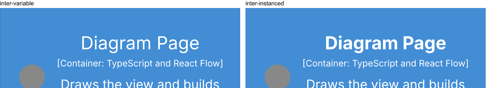
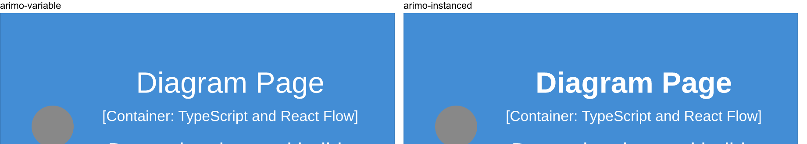
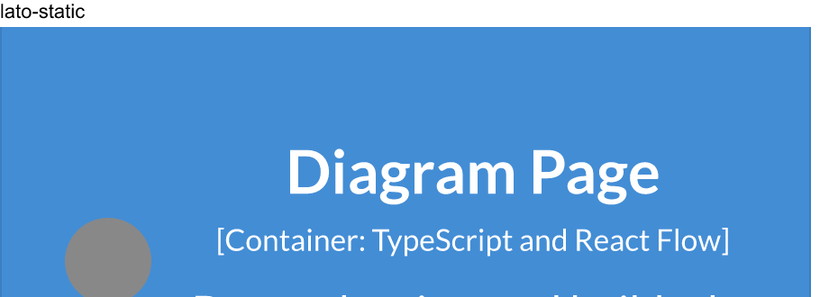

# Prototype: hand resvg static regular and bold faces

Throwaway code for [Prototype: hand resvg static regular and bold faces](https://github.com/FormulaMonks/renderizr/issues/359), part of the map [Map: export views as SVG or PNG from the CLI](https://github.com/FormulaMonks/renderizr/issues/356). Nothing here ships.

## What it does

`driver.ts` bundles `buildGraph`, `exportFrame` and the toolbar's `exportSvg` for Node (esbuild, `--platform=node`). `render.mjs` exports the Containers view of `test/__fixtures__/export.json` with `--font` Inter, Arimo or Lato, measures text with fontkit, rasterizes the PNG with `@resvg/resvg-js` 2.6.2 at twice the export's size and compares the ink of "Banking" drawn bold against regular. `instance.mjs` instances a variable woff2 at a weight: wawoff2 decompresses it and harfbuzzjs's `hb-subset` pins `wght`. `cmp.mjs` diffs PNGs and `crop.mjs` draws the comparisons.

## Results

Measured on macOS arm64 with Node 26.12.

| Faces handed to resvg | Bold ink / regular ink | Font bytes, 400 and 700 |
| --- | --- | --- |
| Inter variable, as Google Fonts serves it to a browser | 1.000 (bold drawn regular) | 47 KB woff2, 120 KB as TTF |
| Inter variable on resvg-js 2.7.0-alpha.2 | 1.000 | same |
| Inter, Google Fonts static TTFs (CSS requested with no browser user agent) | 1.503 | 636 KB |
| Inter, instanced in Node | 1.503 | 131 KB |
| Arimo variable | 1.000 | 20 KB woff2, 35 KB as TTF |
| Arimo, Google Fonts static TTFs | 1.459 | 618 KB |
| Arimo, instanced in Node | 1.459 | 42 KB |
| Lato, a static family | 1.345 | 140 KB |

- Static TTFs from Google Fonts and faces instanced in Node give pixel-identical PNGs (4800 by 4028, 0.000% of pixels differ). The variable face differs from them by 0.26% to 0.28% of pixels, all of it in the bold names.
- Instancing four faces takes 43 ms. The instanced faces measure the same widths in fontkit as the variable face at the same weight and as the static TTFs.
- Each PNG export, measuring included, took 530 to 600 ms.

## Things the research got wrong or left out

- **The native resvg-js has no `fontBuffers`.** resvg-js 2.6.2 takes only `fontFiles` and `fontDirs`; `fontBuffers` exists in `@resvg/resvg-wasm`. Passed to the native package it is ignored, resvg falls back to a system font, and a bold test passes for the wrong reason. The CLI writes the faces to disk, and the `loadFont` cache folder from [Grilling: the font a CLI export draws in without --font](https://github.com/FormulaMonks/renderizr/issues/358) is the place.
- **`fontFiles` takes TTF or OTF, not woff2.** So even a static family the page embeds as woff2 (Lato) needs decompressing before resvg reads it.
- **resvg falls back to a system font even with `loadSystemFonts: false`.** It warns and draws in Arial.

## Comparisons

Left the variable face, right the instanced one.

Lato, a static family:

